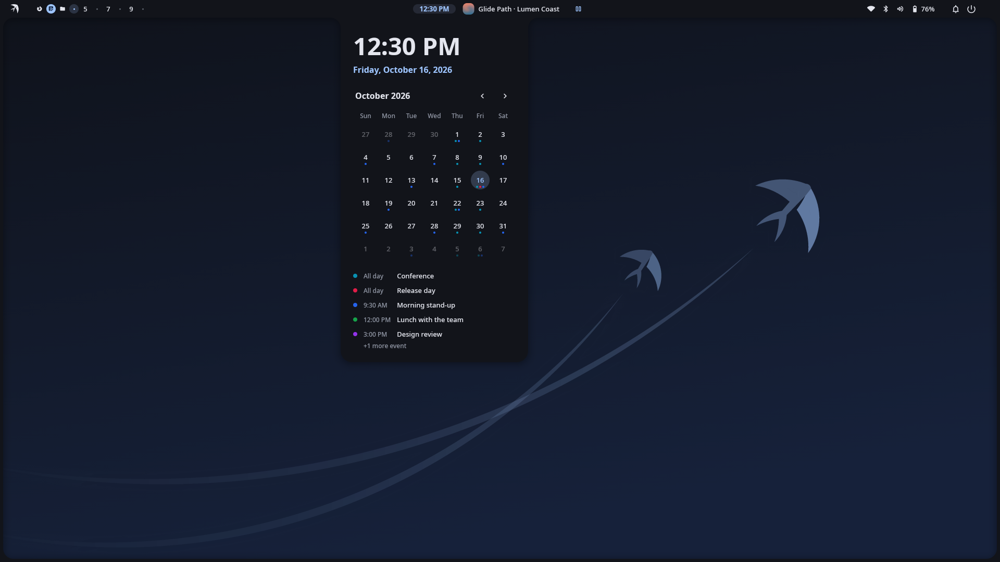

<p align="center">
  
</p>

<h1 align="center">Nuxut Accounts</h1>

<p align="center"><em>The penguin can't fly. This one can.</em></p>

The online accounts core of the [Nuxut](https://github.com/nuxut/shell) desktop: the account model,
sign-in flows (OAuth with PKCE, device code, Nextcloud Login Flow v2) and token storage in the
Secret Service, shared by desktop services such as the
[calendar](https://github.com/nuxut/calendar).

<p align="center">
  
</p>

> **Status:** early. The library is in use; a standalone accounts daemon is being designed.

## Building

```sh
for r in framework accounts; do git clone https://github.com/nuxut/$r.git; done
cd accounts && cargo build --release
```

Architecture: [docs/ARCHITECTURE.md](docs/ARCHITECTURE.md), decisions: [docs/adr/](docs/adr/)
(Turkish).

## Türkçe

Nuxut'un çevrimiçi hesap çekirdeği: hesap modeli, oturum açma akışları ve Secret Service'te
belirteç saklama. Lisans: MIT.

## Contributing and security

See [CONTRIBUTING.md](CONTRIBUTING.md) and [SECURITY.md](SECURITY.md).

## License

[MIT](LICENSE) © 2026 Hakan Göksu
